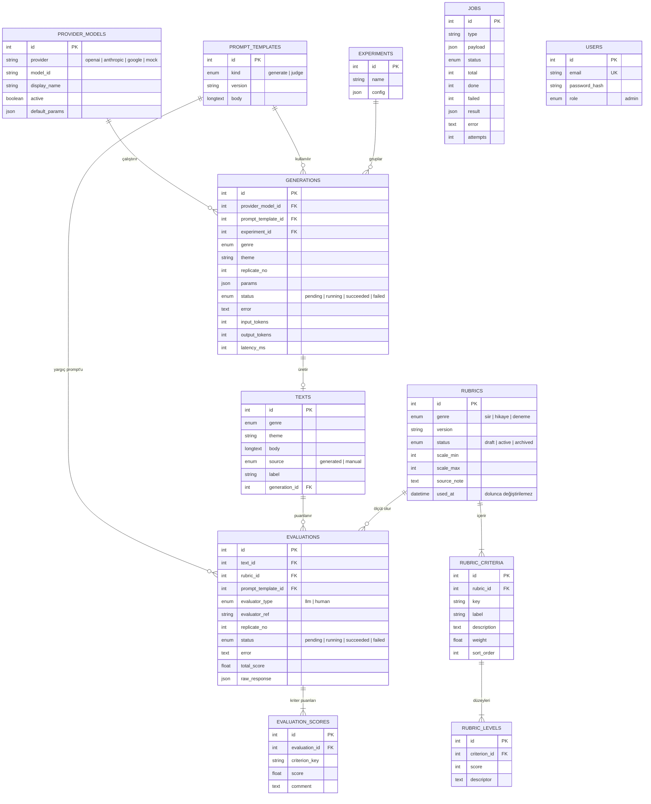

# Veri Modeli (ER Diyagramı)

Kaynak: [`Backend/prisma/schema.prisma`](../../Backend/prisma/schema.prisma). Şema değiştiğinde bu diyagram da güncellenir.

## Önemli tasarım noktaları

- **Başarısızlık görünür:** `generations`, `evaluations` ve `jobs` kayıtları `status` ve `error` taşır. Uydurma puan yazılmaz ([ADR 0004](../adr/0004-sessiz-fallback-yok.md)).
- **Rubrik sürümlü ve kilitlenir:** `rubrics.used_at` dolduktan sonra rubrik değişmez, yeni sürüm açılır ([ADR 0003](../adr/0003-rubrik-veri-olarak.md)).
- **İnsan puanı için hazır:** `evaluations.evaluator_type = human` ile uzman puanları aynı tabloda tutulabilir. Etik kurul onayı gelene kadar bu yolla veri toplanmaz.
- **Tekrarlanabilirlik:** `generations.params`, model kaydı, prompt sürümü ve `replicate_no` bir üretimin yeniden kurulabilmesini sağlar.
