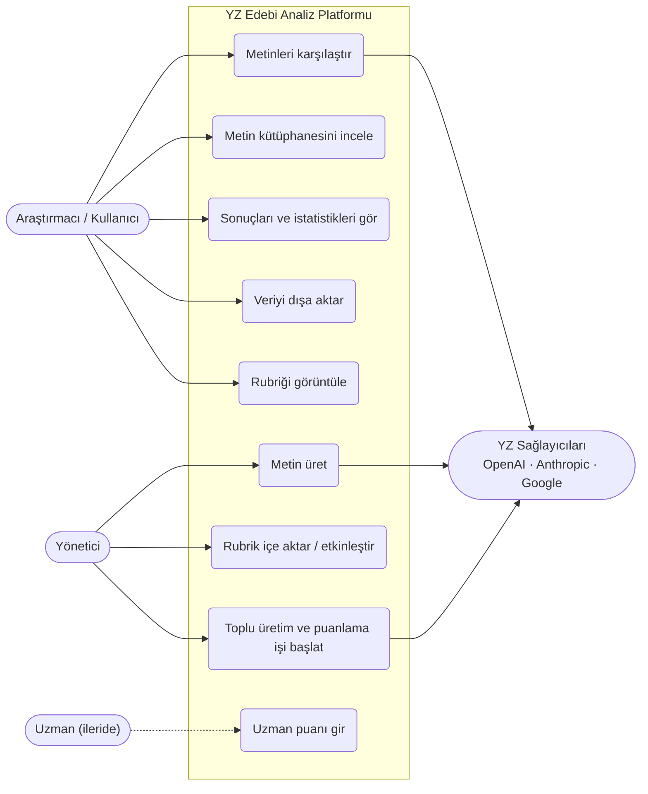
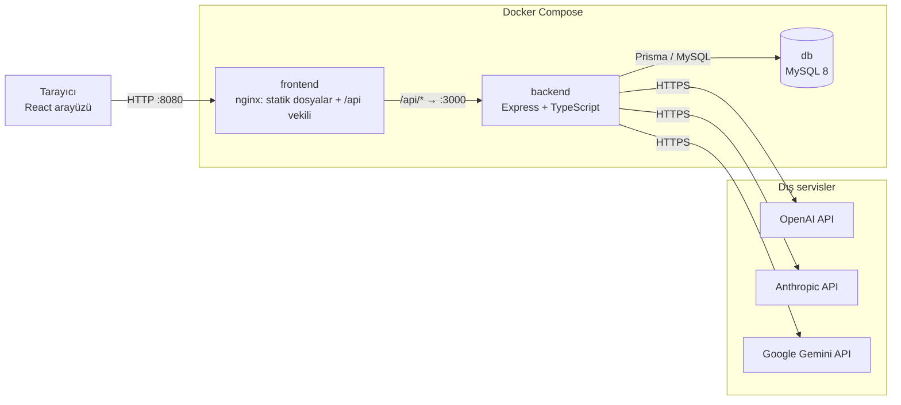
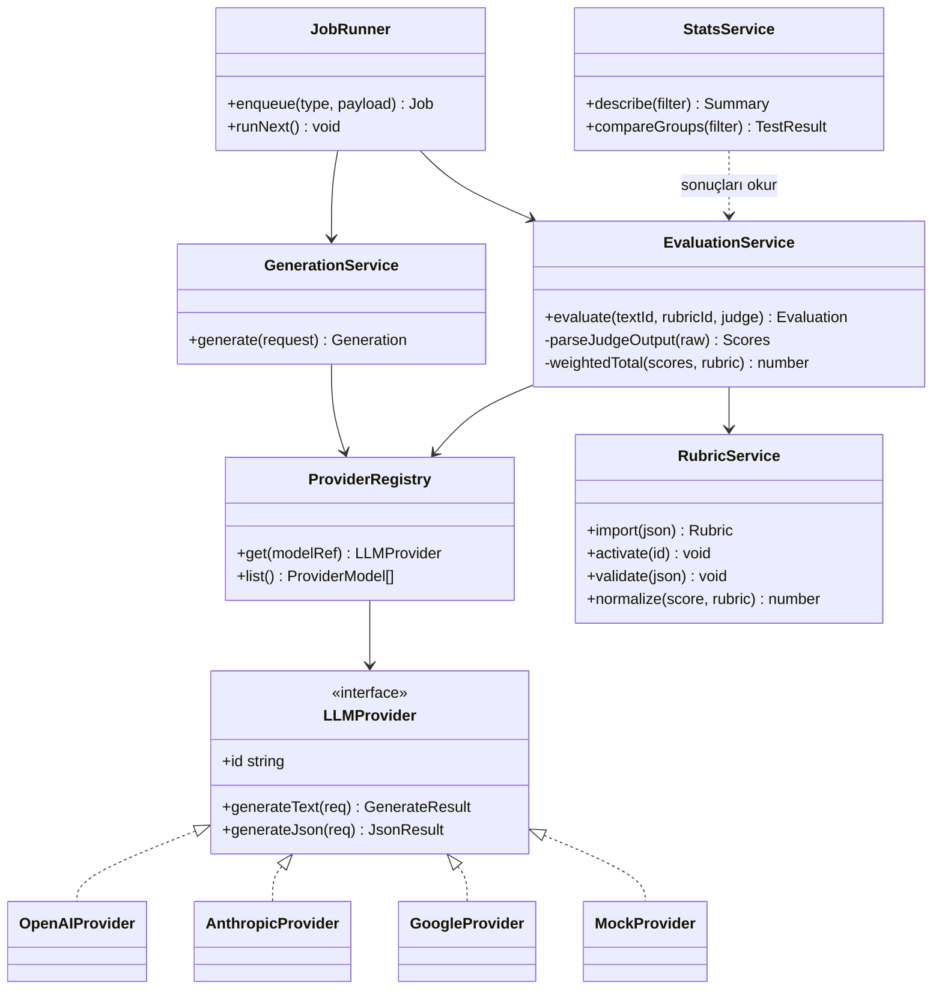
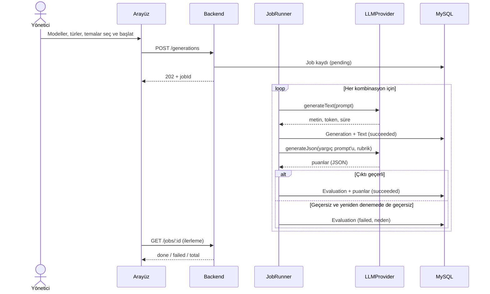
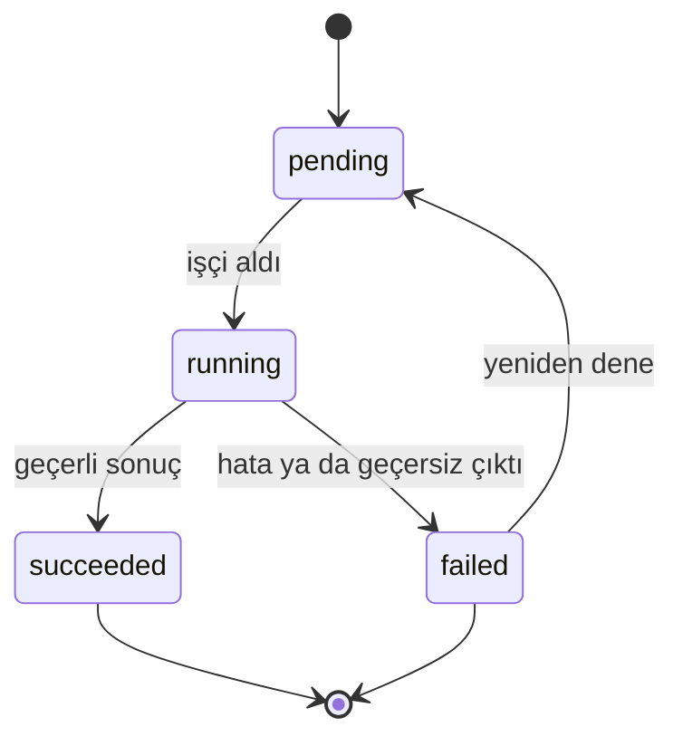
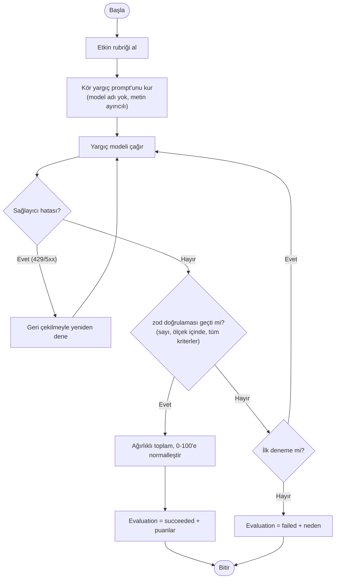

# UML Diyagramları

Diyagramlar [Mermaid](https://mermaid.js.org/) ile yazılmıştır, GitHub'da doğrudan görünür. Bitirme raporu için PNG/PDF olarak dışa aktarılabilir (örn. <https://mermaid.live>).

> Durum notu: "Planlı" olarak işaretlenen bileşenler ilgili faz geldiğinde kodlanır (bkz. [IS_PLANI.md](../IS_PLANI.md)). Bu belge hedef tasarımı gösterir.

## 1. Kullanım durumu diyagramı

Mermaid'de standart kullanım durumu simgesi yoktur, aktör ve kullanım durumları akış şeması ile gösterilmiştir.

## 2. Dağıtım ve bileşen diyagramı

## 3. Sınıf diyagramı (backend çekirdeği, planlı: F1–F2)

## 4. Sıralama diyagramı: toplu üretim ve puanlama (planlı: F2)

## 5. Durum diyagramı: üretim, değerlendirme ve iş durumları

## 6. Etkinlik diyagramı: bir metnin değerlendirilmesi

